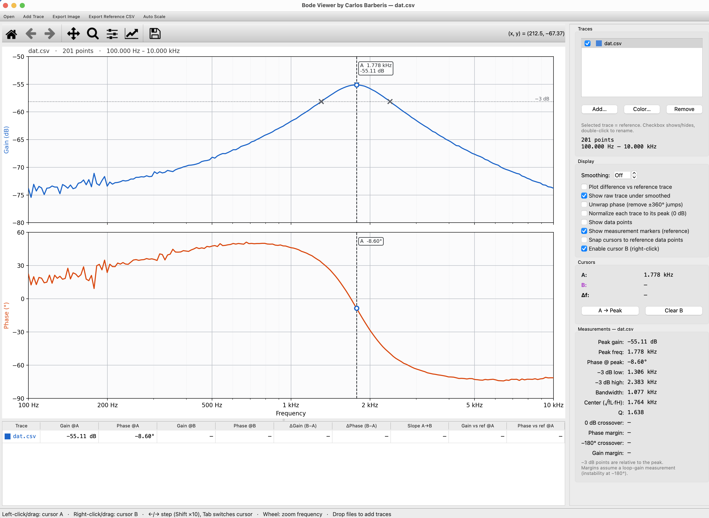

# Bode Viewer

**Clean, measurable Bode plots from Rigol oscilloscope Bode-plot CSV exports — with multi-trace overlay for comparing sweeps.**

Rigol scopes (e.g. with the built-in Bode / FRA function) can export a sweep to CSV, but the on-screen plot is small and hard to measure from. Bode Viewer loads those CSV files and gives you a proper log-frequency gain/phase plot, two measurement cursors, automatic filter and loop-stability measurements, and side-by-side comparison of several sweeps.



---

## Features

### Data import
- Reads Rigol **"RIGOL Bode Data"** CSV files (header block + `Freq / Gain / Phase` table)
- Also accepts any generic CSV with a frequency column followed by gain (dB) and phase (°), with or without a header row
- Cleans the data automatically: sorts by frequency, averages duplicate frequency points, drops invalid rows
- Open files from the menu, from the command line, or by **dragging and dropping** them onto the window

### Plotting
- Log-frequency Bode plot with gain and phase on shared frequency axis
- Automatic "nice" axis scaling and engineering-unit frequency labels (Hz / kHz / MHz)
- Mouse-wheel zoom on the frequency axis (Y axes re-fit to the visible range)
- Standard matplotlib toolbar for pan / zoom / home

### Multi-trace overlay
- Overlay any number of sweeps for comparison (before/after a component change, different builds, temperature runs…)
- Show/hide, rename (double-click), recolor, or remove each trace
- The **selected trace is the reference**: measurements are computed for it, and the cursor table shows every other trace's difference from it
- **"Plot difference vs reference"** mode plots each trace minus the reference (ΔGain / ΔPhase)

### Cursors
| Action | Result |
|---|---|
| Left-click / drag | Cursor A |
| Right-click / drag | Cursor B |
| ← / → | Step active cursor one data point |
| Shift + ← / → | Step 10 points |
| Tab | Switch active cursor |
| Mouse wheel | Zoom frequency axis around the pointer |

Cursors ride along every visible curve. The cursor table shows, for each trace: gain and phase at A and B, ΔGain and ΔPhase (B−A), slope in dB/decade, and gain/phase difference from the reference trace. Optional snapping to the reference trace's data points.

### Automatic measurements (reference trace)
- Peak gain, peak frequency, phase at peak
- −3 dB low / high points (relative to peak), bandwidth, center frequency (√fL·fH), **Q**
- 0 dB crossover with **phase margin**
- −180° crossover with **gain margin**

> Phase/gain margins assume the CSV is a loop-gain measurement (instability at −180°).

### Processing options
- Moving-average smoothing (with optional faint raw trace underneath)
- Phase unwrapping (removes ±360° jumps)
- Normalize each trace to its own peak (0 dB)
- Show individual data points

### Export
- Plot image: **PNG, SVG or PDF** (200 dpi, white background)
- Cleaned / processed reference data as **CSV** (`Freq(Hz), Gain(dB), Phase(deg)`)

---

## Download

Get the latest version from the **[Bode Viewer release page](https://github.com/carlosabarberis/EE-Tools/releases/tag/bode-viewer-v1.1)**:

| Platform | File |
|---|---|
| Windows 10/11 | `.exe` |
| macOS | `.dmg` |

No Python or other software needs to be installed.

**First launch**
- **Windows:** if SmartScreen shows "Windows protected your PC", click **More info ▸ Run anyway**.
- **macOS:** open the `.dmg` and drag **Bode Viewer** to **Applications**. If macOS says it can't verify the developer, right-click the app ▸ **Open** ▸ **Open**.

## Usage

Open one or more CSV files with **File ▸ Open** (Ctrl+O), or drag them onto the window. Use **Add Trace** (Ctrl+Shift+O) or drop more files to overlay additional sweeps.

### Keyboard shortcuts
| Shortcut | Action |
|---|---|
| Ctrl+O | Open file(s) (replaces current traces) |
| Ctrl+Shift+O | Add trace(s) |
| Ctrl+S | Export image |
| Ctrl+E | Export reference CSV |
| Ctrl+R | Auto scale |

On macOS use ⌘ instead of Ctrl.

### Exporting from a Rigol scope
Run the Bode sweep on the scope, then save the result as CSV (Storage / Save ▸ Bode data, file type CSV) to a USB stick and open it in Bode Viewer. Menu names vary slightly by model and firmware.

---

## Supported CSV format

A typical Rigol export looks like this — the `Key:,Value` header lines are kept as metadata (shown as a tooltip on the trace info), and the table starts at the row beginning with `Freq`:

```
RIGOL Bode Data
Start Freq:,10
Stop Freq:,1000000
...
Freq(Hz),Gain(dB),Phase(deg)
10,-0.02,-0.5
...
```

Columns are matched by name (`gain` / `db` / `mag`, `phase` / `deg`). A header-less file with numeric columns `freq, gain, phase` also works.

---

## License

See [LICENSE](../LICENSE) in the root of the EE-Tools repository.

## Author

Part of **[EE-Tools](https://github.com/carlosabarberis/EE-Tools)** — a collection of electronics engineering utilities.

**Carlos Barberis** — [Bartek Technologies](https://bartek.com) · carlos@bartek.com

Other tools: [STM32 TFT Designer](https://github.com/carlosabarberis/STM32-TFT-Designer) · [STM32 OLED Designer](https://github.com/carlosabarberis/STM32-OLED-Designer)
