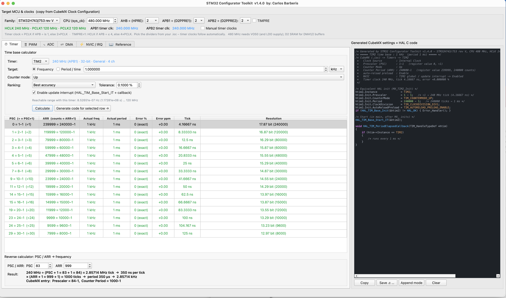

# STM32 Configurator Toolkit

**An all-in-one desktop calculator for configuring STM32 timers, PWM, ADC, DMA and NVIC — that writes the CubeMX settings and HAL C code for you.**

Stop doing PSC/ARR arithmetic on paper. Enter your clock tree once, pick a peripheral tab, type what you want (a frequency, a duty cycle, a sample rate, a dead time), and the toolkit gives you the exact register values, shows the error, and generates ready-to-paste CubeMX settings and HAL code for STM32CubeIDE.

---

## Supported families

STM32F1 · F4 · F7 · G0 · G4 · L4 · H7, plus dedicated profiles for **STM32H743/753 rev V (480 MHz)** and **rev Y (400 MHz)** with H7-specific notes on D1/D2/D3 SRAM placement, DTCM restrictions and ADC3/BDMA.

## Clock setup (top of the window)

Copy your values from the CubeMX *Clock Configuration* tab: CPU clock, AHB prescaler (H7), APB1/APB2 dividers and TIMPRE (F7/H7). The **timer kernel clocks are derived automatically** using the RCC rule (×2 when the APB divider ≠ 1, ×4 with TIMPRE), with warnings if any bus exceeds the family's maximum. A *Manual timer clocks* option lets you type the "APBx Timer clocks" values directly.

---

## Tabs

### ⏱ Timer — time base solver
- Enter a target **frequency or period**; the solver searches every PSC/ARR pair and ranks them
- Ranking by **best accuracy** or **highest resolution within a tolerance**
- Results table: PSC, ARR, actual frequency/period, error in % and ppm, tick time, resolution in bits
- Supports up, down and all three center-aligned counter modes; 16- and 32-bit timers (TIM2/TIM5 where applicable)
- Shows the reachable frequency range for the selected timer
- **Reverse calculator:** PSC/ARR → frequency, with a step-by-step explanation
- Generates `MX_TIMx_Init`-style code with optional update interrupt and `HAL_TIM_PeriodElapsedCallback`

### ∏ PWM — PWM designer
- PWM frequency → PSC/ARR, automatically choosing the highest duty-cycle resolution within your tolerance
- Edge-aligned or center-aligned, PWM mode 1/2, active-high/low polarity
- **Design from resolution:** enter bits or duty step size and get the highest PWM frequency (or the closest to your target) — plus a resolution vs. frequency trade-off table
- Per-channel duty → **CCR value**, pulse width and actual duty (up to 4 channels)
- **Dead-time DTG encoder** for advanced timers (TIM1/TIM8/TIM20) with CKD selection, complementary outputs (CHxN) and break input
- Generated code includes channel config, break/dead-time config, start calls and a `PWM_SetDuty()` runtime helper

### ∿ ADC — conversion timing
- Conversion time per channel, scan-sequence time, maximum sample rate
- Family-specific sampling-time options, resolutions and ADC clock limits
- **Timer-TRGO triggered sampling:** computes the trigger timer for a target sequence rate and checks for overrun
- **Source impedance check** (AN2834 method): minimum sampling cycles for your source resistance and the maximum R_AIN for the current setting
- Generates ADC + trigger-timer setup, DMA start, half/full-complete callbacks and a raw→mV macro

### ⇄ DMA — buffer planning
- **ADC circular double-buffer planner:** buffer size, HT/TC callback rate, CPU-cycle budget per half, NDTR limit check, D-cache alignment (F7/H7) and H743 RAM-domain guidance; generates buffer + callback code (with linker-section snippet for H743)
- **SPI display throughput:** frame size, transfer time, max fps, DMA chunk count and line-buffer sizing for TFT displays
- **PWM waveform LUT generator:** sine, triangle, sawtooth or half-wave sine table for DMA-driven PWM (SPWM / audio / arbitrary waveforms), emitted as a C array with `HAL_TIM_PWM_Start_DMA` code

### ⚡ NVIC / IRQ
- Priority grouping with level counts for the selected core (M0/M0+ handled separately)
- Editable interrupt plan table with **FreeRTOS `configLIBRARY_MAX_SYSCALL_INTERRUPT_PRIORITY` rule checking** — flags ISRs that call RTOS APIs at too high a priority
- Validate & sort by preemption order; generates `HAL_NVIC_SetPriority` / `EnableIRQ` code
- **ISR CPU-load estimator:** cycles per ISR (including entry/exit overhead) → CPU load and absolute maximum ISR rate

### 📖 Reference
A built-in cheat sheet: timer clock rules, time-base and PWM formulas, DTG encoding table, ADC timing and impedance formulas, DMA/cache rules and NVIC priority basics.

---

## Code panel

Every tab writes to the code panel on the right: a commented block with the **CubeMX (.ioc) settings to enter**, followed by the **equivalent HAL C code**, with syntax highlighting. Values are written in CubeMX style (e.g. `Prescaler = 84 - 1`, `Period = 1000 - 1`) with the resulting tick and period in comments.

- **Copy** to clipboard
- **Save .c …** to file
- **Append mode** — accumulate code from several tabs into one listing
- **Clear**

---

## Download

Get the latest version from the **[STM32 Configurator Toolkit release page](https://github.com/carlosabarberis/EE-Tools/releases/tag/stm32-configurator-toolkit-v1.4.0)**:

| Platform | File |
|---|---|
| Windows 10/11 | `.exe` |
| macOS | `.dmg` |

No Python or other software needs to be installed.

**First launch**
- **Windows:** if SmartScreen shows "Windows protected your PC", click **More info ▸ Run anyway**.
- **macOS:** open the `.dmg` and drag **STM32 Configurator Toolkit** to **Applications**. If macOS says it can't verify the developer, right-click the app ▸ **Open** ▸ **Open**.

## Usage

Typical workflow:
1. Select your MCU family and enter the clock dividers from your `.ioc`
2. Pick a tab, enter the target values and click **Calculate**
3. Click **Generate code →** and copy the CubeMX settings / HAL code into your project

> **Note:** ADC R_ADC / C_ADC defaults are typical approximations. Always confirm limits against your specific part's datasheet. Not every timer TRGO can trigger every ADC — check the External Trigger list in CubeMX.

---

## License

See [LICENSE](../LICENSE) in the root of the EE-Tools repository.

## Author

Part of **[EE-Tools](https://github.com/carlosabarberis/EE-Tools)** — a collection of electronics engineering utilities.

**Carlos Barberis** — [Bartek Technologies](https://bartek.com) · carlos@bartek.com

Other STM32 tools: [STM32 TFT Designer](https://github.com/carlosabarberis/STM32-TFT-Designer) · [STM32 OLED Designer](https://github.com/carlosabarberis/STM32-OLED-Designer)
