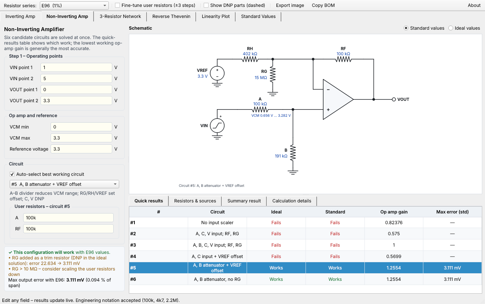
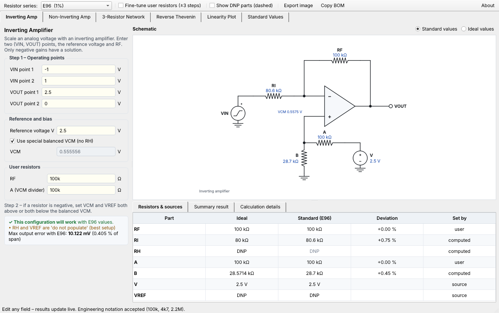
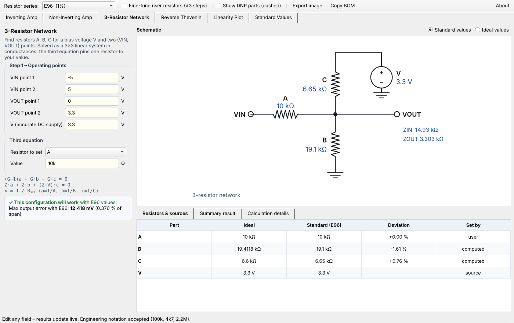
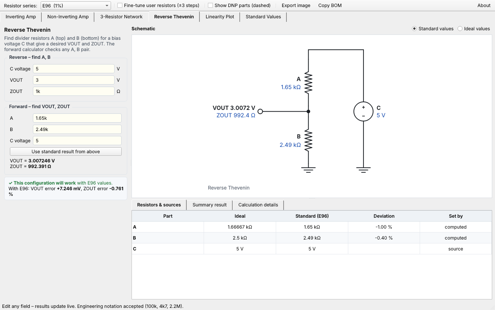
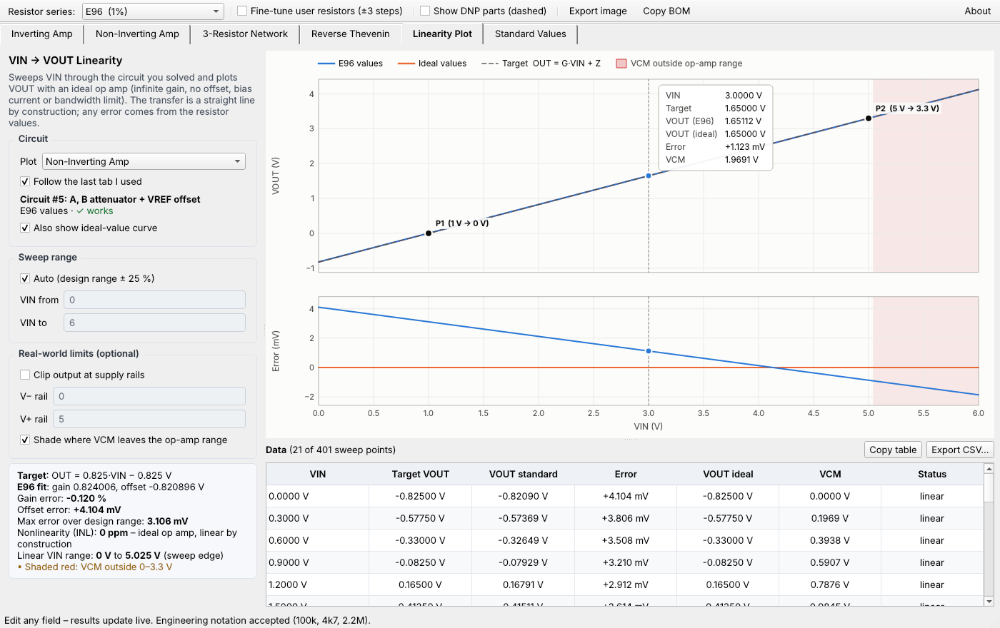

# Voltage Scaler Calculator

**Pick the right op-amp scaling circuit and solve its resistors from two operating points.**

Voltage Scaler is a desktop app for macOS and Windows. You enter where you want two input voltages to land (for example a 1–5 V sensor into a 0–3.3 V ADC), and it chooses a circuit topology, solves the resistor values, rounds them to standard E-series parts, and draws the schematic.

It started as a Python port of Texas Instruments' *Analog Voltage Scaler Calculator* spreadsheet (rev 1.02). It reproduces that workbook's results and adds standard-value optimization, live schematics and a linearity plot.



---

## Download

Get the latest version from the **[Releases page](https://github.com/carlosabarberis/EE-Tools/releases)**.

| Platform | File | Install |
|---|---|---|
| **macOS** 11 or later | `VoltageScaler-1.1.dmg` | Open the DMG and drag **Voltage Scaler** onto **Applications**. Signed and notarized by Apple. |
| **Windows** 10 / 11 | `VoltageScaler-1.1-Windows.zip` | Unzip anywhere and run `VoltageScaler.exe`. If SmartScreen appears, click **More info → Run anyway**. |

---

## What it does

### Inverting amplifier
Solves RF, RI, RH and the VCM divider (A, B) for any **negative-gain** mapping. It defaults to the *balanced VCM*, which makes RH and VREF unnecessary, and it picks automatically whether RH should go to VREF or to ground.



### Non-inverting amplifier: six candidate circuits
For **positive-gain** mappings it solves all six circuits from the TI workbook at once and shows which work. A circuit works when every resistor is positive, VCM stays inside your op amp's common-mode range at both points, and the output actually hits both targets. Among the working circuits it picks the one with the **lowest noise gain**, which is generally the most accurate. Ties go to the circuit with fewer parts.

| # | Circuit | Typical use |
|---|---|---|
| 1 | A only, RF/RG/RH + VREF | Gain ≥ 1, input already inside the VCM range |
| 2 | A–C divider to V, RF, RG | Positive offset |
| 3 | A, B, C network (often a unity buffer) | Attenuate and shift, e.g. ±10 V → 0–2.5 V |
| 4 | A–C divider + VREF offset | Input goes below VCM min |
| 5 | A–B attenuator + VREF offset | Input goes above VCM max |
| 6 | A–B attenuator, no RG | Negative offset |

### 3-resistor network
A passive A/B/C divider to a reference V, for gains between 0 and 1. You fix one resistor and it solves the other two.



With conductances a = 1/A, b = 1/B, c = 1/C, the output node gives

```
VOUT = (VIN·a + V·c) / (a + b + c)      →   G = a/(a+b+c),   Z = V·c/(a+b+c)
```

so with A chosen:

```
RC = G·V·A / Z          RB = G·V·A / (V·(1−G) − Z)          ZOUT = G·A
```

### Reverse / forward Thevenin
Finds the divider resistors A (top) and B (bottom) for a bias voltage C that give a desired VOUT and ZOUT. The forward mode checks any A, B pair.



### Linearity plot
Sweeps VIN through the circuit you solved and plots VOUT with an ideal op amp, together with the **output error in mV**. You get gain error, offset error, maximum error and nonlinearity. Optionally you can clip at your supply rails and shade the regions where VCM leaves the op-amp range, which shows the usable linear input range. Data exports to CSV.



### Standard values
E48, E96 and E192 values are **computed from the IEC 60063 formula**, not read from tables. This includes the one IEC exception: 920 in E192, where the formula gives 919. For any resistance the app shows the nearest, round-down and round-up values in each series.

---

## Ideal vs. standard values

Every result is shown twice:

- **Ideal**: the exact math. These values match the TI spreadsheet.
- **Standard**: built from real parts. Your chosen resistors are rounded first, the remaining values are recomputed from those real parts, and then the last resistors are chosen from neighbouring standard values to minimize the worst-case output error while keeping VCM legal.

**Fine-tune user resistors** also lets the optimizer move your chosen resistors up to ±3 standard steps. A part that is "do not populate" (DNP) in the ideal solution is only added as a trim resistor if it at least halves the error, and the app tells you when it does.

## Other features
- **Live schematic** of the solved circuit. DNP parts are omitted (or shown dashed), 0 Ω parts are drawn as wires, and negative (non-viable) values are shown in red. Export as PNG or SVG.
- **Engineering notation** everywhere: `100k`, `4k7`, `2.2M`, `1e5`.
- **Copy BOM** puts the parts list and resulting output voltages on the clipboard.

---

## Quick example: 1–5 V sensor into a 3.3 V ADC

1. Open the **Non-Inverting Amp** tab.
2. Enter VIN 1 V → VOUT 0 V and VIN 5 V → VOUT 3.3 V, VCM range 0–3.3 V, reference 3.3 V.
3. Quick results shows circuits #5 and #6 working with a noise gain of 1.25. The app picks #5 and draws it.
4. With E96 parts the worst-case output error is about 3 mV, roughly 0.1 % of span.
5. Open **Linearity Plot** to see the error across the range and where the input would leave the op amp's VCM window.

---

## Run from source

Requires Python 3.9+ and PySide6.

```bash
pip install PySide6
python run_voltage_scaler.py
python tests/test_engine.py      # checks the engine against the TI workbook's results
```

## Differences from the TI spreadsheet

- **Circuit #6:** the workbook's B formula tests an empty cell, so B is always DNP. The intended test is used here.
- **VOUT check:** the sheet's "works" test never checks VOUT, so degenerate cases could pass. The app also requires the circuit to hit both targets.
- **Inverting summary VOUT:** uses the VREF actually selected (0 V when RH goes to ground).
- **E96 453:** the TI table prints 452; the IEC value is 453.

---

## Credits & disclaimer

Based on the Texas Instruments *Analog Voltage Scaler Calculator* spreadsheet. Python/PySide6 application by **Carlos Barberis**, Bartek Technologies.

Results are calculated with an ideal op-amp model. Always verify a design against your op amp's datasheet (input common-mode range, output swing, offset and bias currents) before committing to hardware. No warranty is expressed or implied.

© 2026 Carlos Barberis. All rights reserved.
